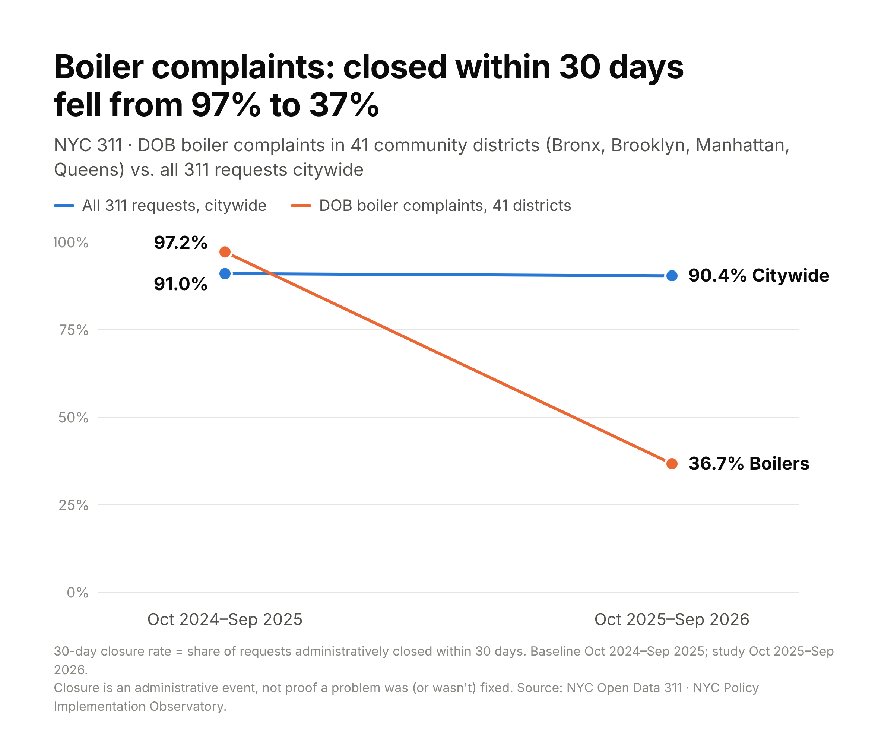

# NYC Policy Implementation Observatory

**A monitoring and screening tool for NYC 311 service data: where did demand change, where did response slow down, and what deserves a closer look?**

> **Status: work in progress.** The data pipeline and analysis are working. The public dashboard and follow-up checks are still being built.

## Why this project

NYC 311 receives millions of service requests a year. The data is open, but it is hard to see where things are changing. This project compares two full years of 311 requests across boroughs, agencies, services and community districts. Then it flags the specific combinations that changed the most, so a person can investigate them.

**Research questions**

1. **Did New Yorkers ask for more help, and did the city keep up?** Compared with the year before, how many 311 requests came in, and what share were closed within 30 days?
2. **Where should we look more closely?** Which types of requests, in which neighborhoods, saw the biggest change in how quickly they were closed?

The study year is October 2025–September 2026. The comparison year (baseline) is October 2024–September 2025. Neighborhoods are measured as NYC's 59 community districts.

## What I found so far

- **Demand grew, performance held.** Requests rose about 10%, from 3.60M to 3.96M. The citywide 30-day closure rate barely moved, from 91.0% to 90.4%.
- **50 investigation leads.** These are agency × service × community-district combinations with at least 30 requests in both years, ranked by volume and by change in closure rate.
- **41 of the 50 leads are the same issue: Department of Buildings (DOB) boiler complaints.** Across 41 districts in the Bronx, Brooklyn, Manhattan and Queens, the share closed within 30 days fell from 97% to 37%.



**How to read this:** A drop this large, and this uniform across boroughs, may reflect a change in process or classification rather than a breakdown in service. Checking that is the next step.

## What this does *not* claim

- **311 measures reported demand,** not all need. It also does not count unique incidents.
- **"Closed" is an administrative status.** It does not prove a problem was fixed, and an open request does not prove it was ignored.
- **The 50 leads are screening flags.** They are not findings of agency failure, rankings, or evidence of policy effects.
- **The policy evidence layer is pending.** This project does not yet link 311 patterns to specific policies or laws. Relevant public government sources include [NYC Legistar](https://legistar.council.nyc.gov/) (local laws) and the [NYC Mayor's Management Report](https://www.nyc.gov/site/operations/reports/mmr.page) (agency performance).

## How it's built

- **Data:** [NYC Open Data 311 Service Requests](https://data.cityofnewyork.us/Social-Services/311-Service-Requests-from-2010-to-Present/erm2-nwe9), 24 months (about 7.6M requests)
- **Pipeline:** Python. Paginated ingestion with monthly source-to-database reconciliation and independent metric validation.
- **Storage:** PostgreSQL (Neon)
- **Semantic layer and dashboard:** Cube
- **Automation:** GitHub Actions
- **Testing:** unit tests for 30-day boundaries, daylight saving, weighted rates and edge cases

See the [methodology](docs/methodology.md), the [data dictionary](docs/data-dictionary.md) and the [executive brief](docs/executive-brief.md).

## Next steps

1. **Check the boiler pattern:** look for changes in DOB complaint classification or closure workflow before interpreting the drop.
2. **Add neighborhood context:** link American Community Survey (ACS) data at the community-district level.
3. **Publish the dashboard** for public viewing.

Feedback is welcome, especially from people who work with NYC government data. Please open an issue or reach out.

---

## For developers

Current delivery notes are in [docs/current-progress.md](docs/current-progress.md).

### Run locally

Python 3.11+; Node 24 for frontend tests. Core execution uses Python's standard library; no package installation is necessary from this checkout.

```bash
python3 -m observatory.cli init
python3 -m observatory.cli export --as-of 2026-10-27T00:00:00-04:00
python3 -m observatory.cli serve --port 8000
```

`.env.example` documents secure process bindings; the app does not automatically load `.env`.

### Populate after source access is enabled

The `ingest-311` and `ingest-acs` commands are the active pipeline for this
project's scope (311 demand/performance monitoring). The `discover-policies`,
`discover-events`, `discover-news` and `import-policies`/`import-links` commands
below are retained code for the retired policy-registry attempt; they are not
part of the current research questions and do not need to run. The policy evidence layer is pending;
public government sources such as NYC Legistar and the NYC Mayor's Management
Report are the reference points for that layer.

```bash
python3 scripts/probe_access.py
python3 -m observatory.cli ingest-311
python3 -m observatory.cli ingest-acs
python3 -m observatory.cli discover-policies       # retired scope, kept for reference
python3 -m observatory.cli discover-events          # retired scope, kept for reference
python3 -m observatory.cli discover-news --max-pages 200   # retired scope, kept for reference
# Review official candidates and populate the input CSV contracts before importing:
python3 -m observatory.cli import-policies --input data/inputs/policies.csv   # retired scope
python3 -m observatory.cli import-links --input data/inputs/policy_service_links.csv   # retired scope
python3 -m observatory.cli import-agency --input data/inputs/agency_performance.csv
python3 -m observatory.cli export --as-of 2026-10-27T00:00:00-04:00
python3 -m observatory.cli validate --as-of 2026-10-27T00:00:00-04:00
```

Full 311 ingestion spans 24 months and may require millions of rows, significant disk and time. It validates schema, uses keyset pagination, upserts IDs and reconciles monthly counts to the source. `--max-pages` creates an explicitly partial smoke run, which cannot enable priority flags. Reruns refresh mutable closures; stale/deleted source rows cause count failures for investigation rather than silent deletion. Downloads preserve HTTPS verification.

Discovery creates candidates, never implementation claims. Broad source review and deduplication follow [methodology](docs/methodology.md). News seed URLs are provisional acquisition targets, not verified working endpoints. The bounded news crawler always records incomplete coverage.

The former smoke workflow has been removed to avoid confusing a bounded test
with a research result. Formal analysis uses the complete production load. Store the
direct Neon connection string in the repository Actions secret
`NYC_DATABASE_URL`; workflows map it to `DATABASE_URL`. Never commit it.

### Cube deployment

See [deployment and feature inspection](docs/cube-deployment.md). Cube reads the
files under `model/cubes/` from the repository root. Reviewed analysis tables
provide dashboard-ready totals, borough comparisons, 50 operational priorities
and explicit source-coverage status.

The `Load production research data` GitHub Actions workflow retrieves the complete
October 2024 through September 2026 311 baseline and study window, performs monthly
source/database reconciliation, independently validates derived metrics, and then
publishes the validated aggregate tables to Neon. ACS and Council discovery report
their own outcomes and do not conceal or block the required 311 validation path.

Configure the exact `CUBE_API_URL` and a query token as `CUBE_API_TOKEN`, run `inspect-cube`, restart the server, then select **Cube REST**. Tokens stay server-side. The server rejects Cube metric counts that do not reconcile to the local evidence export. Registry/provenance still comes from that export and is labeled accordingly. A query token does not grant Cloud management permissions.

The local three-page application is separate from native Cube Dashboard objects.
The semantic models required for the three native pages are deployed; a native
Cube dashboard draft exists.
Of the three pages, **Neighborhood Equity** and **Operational Priorities** are
the project's current scope. **Policy Responsiveness** reflects the retired
policy-registry attempt and currently shows an honest coverage gap (no rows);
pending a decision, it should either be dropped from the demo rotation or
relabeled as a pending policy evidence layer instead of implying in-house coverage.
Use the
[Cube dashboard build guide](docs/cube-dashboard-guide.md) for the exact native
page fields, filters, caveats and acceptance totals.

### Verify

```bash
python3 -m unittest discover -s tests -v
npm test
python3 -m observatory.cli validate --as-of 2026-10-27T00:00:00-04:00
```

Tests cover independent expected counts, 30-day boundaries, daylight saving, matched maturity, weighted rates, future/invalid closures, request upserts, policy evidence deduplication, quotation verification, ACS county grain and filter calculations. Validation independently reconciles SQL request grain to metric cells, hashes and foreign keys. Empty-data validation is explicitly **structural only**, not research validation.

### Structure

All repository directory and file names use English ASCII names. Documentation content may be Chinese.

`observatory/`: acquisition, storage, metrics, analysis and server. `sql/`:
tables/constraints. `model/cubes/`: PostgreSQL-backed cubes and query views.
`web/`: interactive pages. `data/inputs/`: review contracts. `docs/`: research
and deployment documentation. `reports/`: analysis and validation evidence.
`tests/`: isolated fixtures. `scripts/`: brief generation and model checks.

Do not commit secrets, caller data, addresses, large raw datasets, or synthetic
observations as research data.
